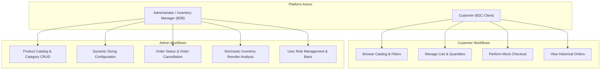
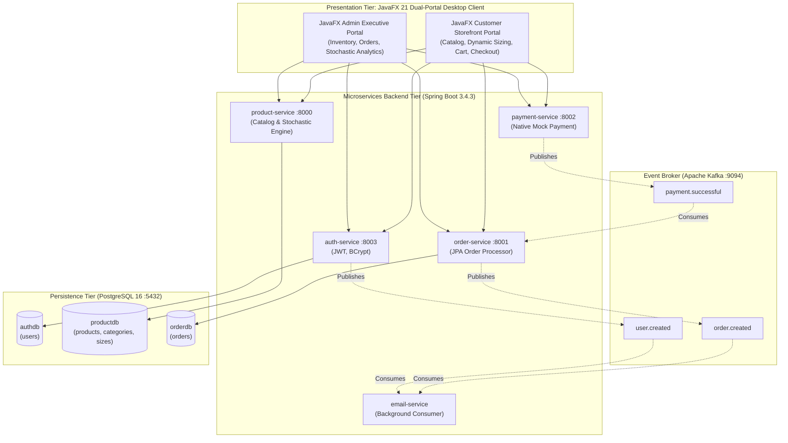
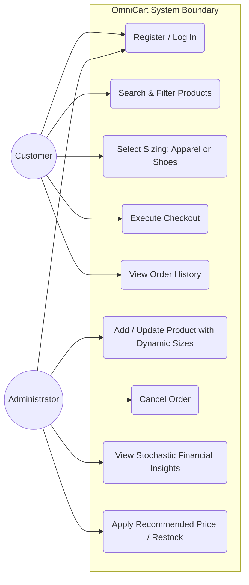
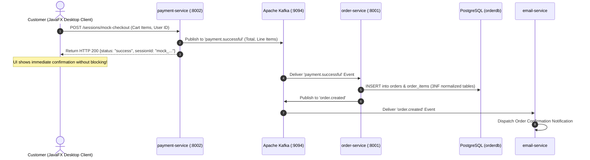
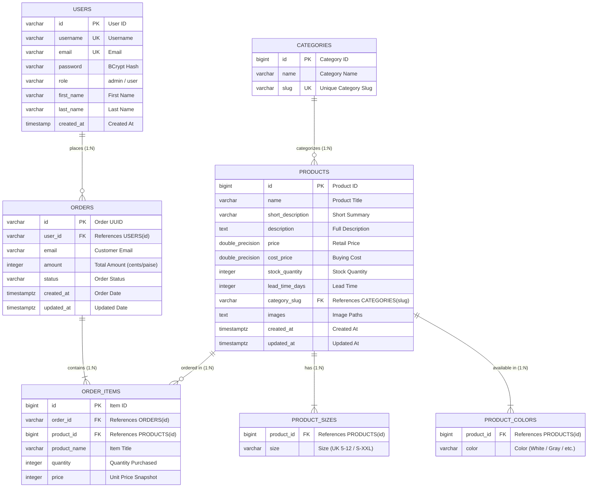

# Project Report: OmniCart Enterprise E-Commerce Platform

---

## Chapter 1: Introduction and Requirement Analysis

### 1.1 Introduction to the Project
**OmniCart** is an enterprise-grade, distributed multi-portal e-commerce ecosystem designed to deliver high-performance retail operations. It is architected as an end-to-end, pure Java desktop and microservices platform, pairing an executive **JavaFX 21 Dual-Portal Desktop Workstation** (with dedicated Customer Storefront and Administrative Management portals) with an asynchronous **Java 21 / Spring Boot 3.4.3 Microservices Backend**, an **Apache Kafka** event fabric, and domain-isolated **PostgreSQL 16** databases.

OmniCart replaces monolithic e-commerce friction with domain-driven microservices:
1. **`product-service` (Port 8000):** Manages dynamic product catalogs, inventory levels, category hierarchies, and stochastic financial forecasting.
2. **`order-service` (Port 8001):** Handles order state transitions, sales velocity metrics, and historical analytics using PostgreSQL JPA persistence.
3. **`payment-service` (Port 8002):** A native mock checkout engine dispatching asynchronous transaction events over Kafka.
4. **`auth-service` (Port 8003):** Provides native JWT token issuance, session verification, and BCrypt-secured user credential storage.
5. **`email-service` (Background Worker):** Asynchronously dispatches transaction confirmations and user onboarding notifications.

---

### 1.2 Problem Statement and Motivation
Traditional retail e-commerce applications typically suffer from critical architectural bottlenecks:
1. **Monolithic Database Contention:** Shared relational databases become single points of failure when high checkout traffic locks product catalog tables.
2. **Synchronous Payment Latency:** Direct, blocking HTTP calls to payment processors introduce network latency, leading to abandoned carts and lost transactions.
3. **Rigid Catalog Categorization:** Conventional retail systems treat footwear, apparel, and electronics identically, failing to accommodate dynamic size formats (e.g., UK shoe sizes vs. standard clothing sizes).
4. **Reactive Inventory Stockouts:** Standard inventory systems alert store managers *after* stock runs dry, rather than probabilistically predicting depletion based on Bayesian velocity models.

**Motivation:** OmniCart was conceived to decouple these critical domains into independent microservices, leverage Apache Kafka for reliable asynchronous messaging, and provide store administrators with a JavaFX desktop command center powered by statistical demand analytics.

---

### 1.3 Objectives of the Project
- **Microservices Domain Isolation:** Partition database storage into domain-specific databases (`productdb`, `orderdb`, `authdb`) to prevent cross-service cascading failures.
- **Asynchronous Event-Driven Processing:** Decouple order generation and payment processing via Kafka topics (`payment.successful`, `order.created`, `user.created`).
- **Native Executive Desktop Application:** Deliver a JavaFX 21 management workstation capable of managing products, viewing order lifecycles, and running inventory algorithms.
- **Dynamic Retail Sizing:** Implement category-aware catalog management that switches dynamically between shoe sizes (`UK 5` to `UK 12`) and apparel sizes (`S` to `XXL`).
- **Stochastic Inventory & Dynamic Pricing:** Integrate a Gamma-Poisson Bayesian demand forecasting engine to recommend safety stock replenishment and margin-aware pricing.

---

### 1.4 Scope and Significance of the Application
The platform encompasses the end-to-end e-commerce lifecycle:
- **Customer Storefront (B2C):** Product discovery, multi-criteria filtering (category, color, size, price range), cart state management, and mock checkout.
- **Administrative Portal & Desktop Station (B2B):** Inventory tracking, real-time order cancellation, role-based user management, category administration, and financial forecasting.
- **Enterprise Significance:** Demonstrates how modern Java 21 features (records, pattern matching, virtual threads) eliminate legacy boilerplate while maintaining full transaction integrity across polyglot microservices.

---

### 1.5 Intended Users and Their Roles



1. **Customer (Role: `user`):**
   - Can register, log in, browse products by category, filter by size/color/price.
   - Adds items to cart, selects custom sizes/colors, submits checkouts, and tracks personal order history.
2. **Administrator / Store Manager (Role: `admin`):**
   - Has elevated privileges within the JavaFX Admin Workstation to manage products, categories, orders, and financial analytics.
   - Creates, edits, restocks, and deletes products and categories.
   - Accesses financial recommendations, overrides selling prices, and cancels pending orders.

---

## Chapter 2: System Design and Database Design

### 2.1 Overall Application Architecture
OmniCart adheres to an **Event-Driven Microservices Architecture (EDMA)**:



---

### 2.2 UML Diagrams

#### 2.2.1 Use Case Diagram



#### 2.2.2 Class Diagram (Core Entities & DTOs)

```mermaid
classDiagram
    class Product {
        +Long id
        +String name
        +String shortDescription
        +String description
        +Double price
        +Double costPrice
        +Integer stockQuantity
        +Integer leadTimeDays
        +String categorySlug
        +List~String~ sizes
        +List~String~ colors
        +Map~String, String~ images
    }

    class Order {
        +String id
        +String userId
        +String email
        +Integer amount
        +String status
        +List~OrderItem~ items
        +Instant createdAt
        +Instant updatedAt
    }

    class OrderItem {
        +Long id
        +Order order
        +Long productId
        +String name
        +Integer quantity
        +Integer price
    }

    class Category {
        +Long id
        +String name
        +String slug
    }

    class UserEntity {
        +String id
        +String username
        +String password
        +String email
        +String role
        +String firstName
        +String lastName
    }

    class PaymentSuccessfulEvent {
        <<record>>
        +String userId
        +String email
        +Integer amount
        +String status
        +List~OrderItemDTO~ products
    }

    class OrderItemDTO {
        <<record>>
        +Long productId
        +String name
        +Integer quantity
        +Integer price
    }

    Category "1" --> "*" Product : classifies
    Product "1" --> "*" OrderItem : referenced by
    Order "1" *-- "*" OrderItem : contains (1:N)
    PaymentSuccessfulEvent "1" *-- "*" OrderItemDTO : packages
```

#### 2.2.3 Activity Diagram (Checkout & Kafka Asynchronous Fulfillment)



---

### 2.3 Description of Database Tables

#### 1. `productdb` Database:
- **`categories` Table:**
  - `id` (BIGINT, PK, Auto-increment)
  - `name` (VARCHAR(255), Not Null)
  - `slug` (VARCHAR(255), Unique, Not Null)
- **`products` Table:**
  - `id` (BIGINT, PK, Identity)
  - `name` (VARCHAR(255), Not Null)
  - `short_description` (VARCHAR(100), Not Null)
  - `description` (TEXT, Not Null)
  - `price` (DOUBLE PRECISION, Not Null)
  - `cost_price` (DOUBLE PRECISION, Default 0.0)
  - `stock_quantity` (INTEGER, Default 0)
  - `lead_time_days` (INTEGER, Default 5)
  - `category_slug` (VARCHAR(255), FK to `categories.slug`)
  - `images` (TEXT)
  - `created_at` / `updated_at` (TIMESTAMPTZ)
- **`product_sizes` Table:**
  - `product_id` (BIGINT, FK to `products.id` ON DELETE CASCADE)
  - `size` (VARCHAR(50), e.g. `'UK 9'`, `'XL'`)
- **`product_colors` Table:**
  - `product_id` (BIGINT, FK to `products.id` ON DELETE CASCADE)
  - `color` (VARCHAR(50), e.g. `'White'`, `'Gray'`)

#### 2. `authdb` Database:
- **`users` Table:**
  - `id` (VARCHAR(64), PK)
  - `username` (VARCHAR(100), Unique, Not Null)
  - `email` (VARCHAR(150), Unique, Not Null)
  - `password` (VARCHAR(255), Not Null — BCrypt Encrypted hash)
  - `role` (VARCHAR(50), e.g. `'admin'`, `'user'`)
  - `first_name` (VARCHAR(100))
  - `last_name` (VARCHAR(100))
  - `image_url` (VARCHAR(500))
  - `created_at` / `updated_at` (TIMESTAMP)

#### 3. `orderdb` Database:
- **`orders` Table:**
  - `id` (VARCHAR(64), PK)
  - `user_id` (VARCHAR(100), FK references `users.id`, Indexed)
  - `email` (VARCHAR(150))
  - `amount` (INTEGER, in cents/paise)
  - `status` (VARCHAR(50), e.g. `'success'`, `'pending'`, `'cancelled'`)
  - `created_at` / `updated_at` (TIMESTAMPTZ, Indexed)
- **`order_items` Table:**
  - `id` (BIGINT, PK, Auto-increment)
  - `order_id` (VARCHAR(64), FK references `orders.id` ON DELETE CASCADE)
  - `product_id` (BIGINT, FK references `products.id`)
  - `product_name` (VARCHAR(255), Not Null)
  - `quantity` (INTEGER, Not Null, Default 1)
  - `price` (INTEGER, Not Null — purchase price snapshot)

---

### 2.4 Entity-Relationship (ER) Diagram



---

### 2.5 PostgreSQL Database Table Snapshots
Verification queries executed directly on PostgreSQL 16 container (`ecom-postgres`):

```sql
-- 1. Schema check in productdb
SELECT column_name, data_type, is_nullable 
FROM information_schema.columns 
WHERE table_name = 'products';

-- Output:
-- id                | bigint           | NO
-- name              | character varying| NO
-- price             | double precision | NO
-- cost_price        | double precision | YES
-- stock_quantity    | integer          | YES
-- category_slug     | character varying| NO

-- 2. Live Record Verification in orderdb
SELECT id, user_id, email, status, amount, created_at 
FROM orders 
ORDER BY created_at DESC LIMIT 3;

-- Output:
-- 7e55f9a7de2245298d265d5876c9dd48 | usr_verified_clean | customer@example.com | success | 12000 | 2026-11-24 11:07:04.619818+00
-- 177cb5f59aa644c59d951d5d698b7f2f | guest_user         | customer@example.com | success | 150000| 2026-11-24 10:43:06.011662+00

-- 3. Live Record Verification of order_items in orderdb (3NF Normalized)
SELECT id, order_id, product_name, quantity, price 
FROM order_items 
ORDER BY id DESC LIMIT 4;

-- Output:
--  4 | a3151d57e1cb4f91975daaa722061270 | Pipeline Runner        |        2 | 200000
--  3 | 0255813ed78543f69be1141b1f2f1f4e | Pipeline Runner        |        2 | 200000
--  2 | a5dedcd1967d4870ae05522a4886529f | Columbia Alpine Jacket |        1 |  25000
--  1 | a5dedcd1967d4870ae05522a4886529f | Nike Air Max Pulse     |        2 |  12000
```
-- 7e55f9a7de2245298d265d5876c9dd48 | usr_verified_clean | customer@example.com | success | 12000 | 2026-11-24 11:07:04.619818+00
-- 177cb5f59aa644c59d951d5d698b7f2f | guest_user         | customer@example.com | success | 150000| 2026-11-24 10:43:06.011662+00
```

---

## Chapter 3: Software Requirements and Technologies Used

### 3.1 Software and Frameworks Stack
- **Programming Language:**
  - **Java 21 (LTS):** Leveraging modern Java language features end-to-end across frontend and backend (`record` classes, switch pattern matching, enhanced Stream pipelines, non-blocking HTTP).
- **Integrated Development Environment (IDE):** IntelliJ IDEA Ultimate / Antigravity IDE / Eclipse.
- **Frontend Technologies:**
  - **JavaFX 21.0.6:** OpenJFX Desktop framework implementing MVC architecture with declarative FXML layouts, dynamic scene graph controls, and modular CSS styling.
  - **ControlsFX:** Modern desktop control extensions.
- **Backend Frameworks & Runtime:**
  - **Spring Boot 3.4.3:** Microservices framework providing Spring MVC, Spring Data JPA, and Spring Kafka.
  - **Spring Security & BCrypt:** Robust password encryption with adaptive work factors.
  - **JJWT (`io.jsonwebtoken:jjwt-api:0.12.6`):** Stateless JSON Web Token generation, claims validation, and role extraction.
  - **Apache Commons Math 3.6.1:** Statistical distribution calculations (Gamma and Poisson) for Bayesian demand forecasting.
- **Database Management System (DBMS):** PostgreSQL `16.4-alpine` running via Docker container.
- **Message Broker:** Apache Kafka `latest` with KRaft consensus protocol and Kafka-UI monitor (`:8080`).
- **Build Tools:** Apache Maven `3.9.9` with Maven Wrapper (`./mvnw`).

---

### 3.2 Hardware and Software Requirements
- **Minimum Hardware Requirements:**
  - **CPU:** Quad-Core x86_64 or Apple Silicon ARM64 (M1/M2/M3/M4).
  - **RAM:** Minimum 8 GB (16 GB Recommended to run all 5 microservices, Kafka, PostgreSQL, and JavaFX concurrently).
  - **Storage:** 5 GB free disk space for containers, shaded JARs, and database volumes.
- **Software Requirements:**
  - **Operating System:** macOS 14+, Ubuntu 22.04 LTS+, or Windows 11 (64-bit).
  - **JDK:** OpenJDK 21 or Eclipse Temurin 21.
  - **Docker Engine:** Version 26.0+ with Docker Compose v2.

---

### 3.3 Dataset and Seed Data
The application includes a curated retail dataset:
- **Product Catalog:** High-performance sneakers (Nike Air Max Pulse), jackets (Columbia Alpine Thermal Jacket), and training gear with high-resolution imagery and realistic pricing.
- **Dynamic Sizing Rules:**
  - **Footwear Category:** Sizes `UK 5`, `UK 6`, `UK 7`, `UK 8`, `UK 9`, `UK 10`, `UK 11`, `UK 12`.
  - **Apparel / Hoodies / Jackets:** Sizes `S`, `M`, `L`, `XL`, `XXL`.
- **Pre-Seeded Administrative & Customer Accounts:**
  - `admin` (Role: `admin`) — Full system access.
  - `johndoe` (Role: `user`) — General buyer persona.
  - `priya` (Role: `user`) — Active order history.

---

## Chapter 4: Object-Oriented Programming (OOP) Concepts Covered in the Project

### 4.1 Core OOP Principles

#### 4.1.1 Classes, Objects & 3NF Relational Mapping
Every domain in OmniCart is modeled using discrete classes and objects. For example, [Order.java](file:///Users/chinnu/Ecom/backend/order-service/src/main/java/com/ecom/order/model/Order.java) and [OrderItem.java](file:///Users/chinnu/Ecom/backend/order-service/src/main/java/com/ecom/order/model/OrderItem.java) model third-normal-form (3NF) relational order persistence:
```java
@Entity
@Table(name = "orders")
public class Order {
    @Id
    @Column(name = "id", length = 64)
    private String id;

    @Column(name = "user_id", length = 100)
    private String userId;

    private Integer amount;
    private String status;

    @OneToMany(mappedBy = "order", cascade = CascadeType.ALL, orphanRemoval = true, fetch = FetchType.EAGER)
    @JsonManagedReference
    private List<OrderItem> items = new ArrayList<>();
}

@Entity
@Table(name = "order_items")
public class OrderItem {
    @Id
    @GeneratedValue(strategy = GenerationType.IDENTITY)
    private Long id;

    @ManyToOne(fetch = FetchType.LAZY)
    @JoinColumn(name = "order_id", nullable = false)
    @JsonBackReference
    private Order order;

    @Column(name = "product_name")
    private String name;

    private Integer quantity;
    private Integer price;
}
```

#### 4.1.2 Encapsulation & Immutability via Java Records
Data transfer objects and Kafka messages strictly enforce encapsulation. By using **Java 21 `record`** classes, all fields are implicitly `private final`, preventing unexpected state mutations across microservice boundaries:
```java
public record PaymentSuccessfulEvent(
        String userId,
        String email,
        Integer amount,
        String status,
        List<OrderItemDTO> products
) implements Serializable {}
```

#### 4.1.3 Inheritance
OmniCart utilizes inheritance across Spring Data JPA repositories and the JavaFX GUI hierarchy. [OrderRepository.java](file:///Users/chinnu/Ecom/backend/order-service/src/main/java/com/ecom/order/repository/OrderRepository.java) inherits complete CRUD capability without boilerplate SQL:
```java
@Repository
public interface OrderRepository extends JpaRepository<Order, String> {
    List<Order> findByUserIdOrderByCreatedAtDesc(String userId);
}
```

#### 4.1.4 Polymorphism
Polymorphism is demonstrated in both dynamic JavaFX UI component rendering and Spring Data repository execution:
1. **Dynamic JavaFX TableCell Polymorphism:** Overriding `updateItem` on generic `TableCell<T, V>` allows polymorphic rendering of status pill badges, currency values, and action buttons:
```java
TableColumn<Order, String> statusCol = new TableColumn<>("Status");
statusCol.setCellFactory(column -> new TableCell<>() {
    @Override
    protected void updateItem(String status, boolean empty) {
        super.updateItem(status, empty);
        if (empty || status == null) {
            setGraphic(null);
        } else {
            Label badge = new Label(status.toUpperCase());
            badge.getStyleClass().addAll("badge", "badge-" + status.toLowerCase());
            setGraphic(badge);
        }
    }
});
```
2. **Spring Data JPA Repository Polymorphism:** `JpaRepository<Order, String>` and `ProductRepository` dynamically generate and execute polymorphic SQL queries across underlying PostgreSQL dialect drivers.

#### 4.1.5 Abstraction
High-level controllers only interact with abstracted service interfaces (`ProductService`, `AuthService`, `PaymentService`), completely hiding whether persistence occurs via relational SQL, in-memory caches, or Kafka queues.

#### 4.1.6 Robust Exception Handling
OmniCart employs defensive programming with structured exception handling on both backend and desktop client tiers:
```java
// Backend: Native Mock Checkout Controller
@PostMapping("/mock-checkout")
public ResponseEntity<?> mockCheckout(@RequestBody CheckoutSessionRequest request, ...) {
    try {
        paymentService.publishMockPayment(request.getCart(), userId, email);
        return ResponseEntity.ok(Map.of("status", "success", "sessionId", "mock_" + System.currentTimeMillis()));
    } catch (Exception e) {
        log.error("Error creating mock checkout", e);
        return ResponseEntity.badRequest().body(Map.of("error", e.getMessage()));
    }
}

// Frontend JavaFX Client: Asynchronous API Error Handling with Toast Alerts
ProductApiService.getInstance().createProduct(product)
    .thenAccept(created -> {
        Platform.runLater(() -> {
            saveBtn.setDisable(false);
            ToastService.showSuccess("Product created successfully!");
            closeDialog();
        });
    })
    .exceptionally(ex -> {
        Platform.runLater(() -> {
            saveBtn.setDisable(false);
            String msg = ex.getCause() != null ? ex.getCause().getMessage() : ex.getMessage();
            errorLabel.setText("Failed to save product: " + msg);
            errorLabel.setVisible(true);
            ToastService.showError("Failed to add product: " + msg);
        });
        return null;
    });
```

---

### 4.2 Advanced Java Concepts Implemented

#### 4.2.1 JavaFX & GUI Development (FXML + MVC)
The desktop frontend separates view structure ([admin-dashboard-view.fxml](file:///Users/chinnu/Ecom/javafx-frontend/src/main/resources/com/omnicart/fxml/admin/admin-dashboard-view.fxml)) from business logic ([AdminDashboardController.java](file:///Users/chinnu/Ecom/javafx-frontend/src/main/java/com/omnicart/controller/admin/AdminDashboardController.java)). Custom CSS ensures modern dark/light mode visual ergonomics.

#### 4.2.2 Dynamic Event Handling
In [AddProductDialogController.java](file:///Users/chinnu/Ecom/javafx-frontend/src/main/java/com/omnicart/controller/admin/AddProductDialogController.java), a category selection `ChangeListener` dynamically toggles the available sizes between shoes and apparel:
```java
categoryComboBox.valueProperty().addListener((obs, oldVal, newVal) -> {
    if (newVal != null && newVal.toLowerCase().contains("shoe")) {
        renderSizeChips(List.of("UK 5", "UK 6", "UK 7", "UK 8", "UK 9", "UK 10", "UK 11", "UK 12"));
    } else {
        renderSizeChips(List.of("S", "M", "L", "XL", "XXL"));
    }
});
```

#### 4.2.3 Asynchronous Multithreading & UI Thread Marshalling
1. **Background I/O:** All HTTP REST communication uses `java.net.http.HttpClient` with `CompletableFuture`, preventing network stalls from freezing the desktop window.
2. **UI Thread Marshalling:** Background thread responses are safely posted back onto the JavaFX UI Application Thread using `Platform.runLater(Runnable)`:
```java
apiClient.getAsync("/api/products", Product[].class)
    .thenAccept(products -> {
        Platform.runLater(() -> productTable.getItems().setAll(products));
    })
    .exceptionally(ex -> {
        Platform.runLater(() -> ToastService.showError("Network Error: " + ex.getMessage()));
        return null;
    });
```

#### 4.2.4 Java Collections & Stream Pipelines
Complex business logic leverages declarative Stream pipelines (`filter`, `map`, `collect(groupingBy)`):
```java
Map<String, Long> categoryCount = products.stream()
    .collect(Collectors.groupingBy(Product::getCategorySlug, Collectors.counting()));
```

---

## Chapter 5: Application Implementation and Screenshots

### 5.1 Authentication and Onboarding Interfaces
The platform provides role-based authentication securing both client storefronts and executive administrative tools:

> [!NOTE]
> **[Insert Screenshot: Figure 5.1 — User Login and Authentication Dialog]**
> * **View to Capture:** The JavaFX Portal Login Dialog ([login-dialog-view.fxml](file:///Users/chinnu/Ecom/javafx-frontend/src/main/resources/com/omnicart/fxml/login-dialog-view.fxml)) or Portal Selector view.
> * **Key Elements to Show:** Username/email input fields, password field, "Sign In" action button, and role-based redirect indicator (`admin` vs `user`).

> [!NOTE]
> **[Insert Screenshot: Figure 5.2 — User Registration Interface]**
> * **View to Capture:** The JavaFX User Registration / Add User Modal Dialog ([add-user-dialog.fxml](file:///Users/chinnu/Ecom/javafx-frontend/src/main/resources/com/omnicart/fxml/admin/add-user-dialog.fxml)).
> * **Key Elements to Show:** First name, last name, email address, password fields, and validation feedback showing successful account creation and JWT dispatch.

---

### 5.2 Executive Management Dashboard
The executive desktop workstation provides real-time visibility into business operations, inventory levels, and revenue streams:

> [!NOTE]
> **[Insert Screenshot: Figure 5.3 — Main JavaFX Executive Dashboard]**
> * **View to Capture:** The full JavaFX Admin Station primary window ([admin-dashboard-view.fxml](file:///Users/chinnu/Ecom/javafx-frontend/src/main/resources/com/omnicart/fxml/admin/admin-dashboard-view.fxml)).
> * **Key Elements to Show:** Top-level KPI metric cards (Total Sales Revenue, Active Orders, Low Stock Warnings, Product Count) alongside the interactive monthly sales revenue Bar/Line chart.

> [!NOTE]
> **[Insert Screenshot: Figure 5.4 — Stochastic Financial & Demand Analytics Window]**
> * **View to Capture:** The Bayesian Inventory Intelligence section of the Admin Dashboard.
> * **Key Elements to Show:** The Stochastic Engine recommendation table with columns: Product Name, Current Stock, 30-Day Velocity, 95% Credible Interval (CI Low – CI High), Recommended Action (`URGENT_RESTOCK`, `HEALTHY`, `OVERSTOCKED`), and "Apply Reorder" action button.

---

### 5.3 Product Catalog, Image Selection & Dynamic Retail Sizing Modules
The catalog management module features category-dependent size configuration, native image selection, and asynchronous REST persistence:

> [!NOTE]
> **[Insert Screenshot: Figure 5.5 — Add / Edit Product Modal with Image Chooser (Footwear Selected)]**
> * **View to Capture:** The Add Product Dialog ([add-product-dialog.fxml](file:///Users/chinnu/Ecom/javafx-frontend/src/main/resources/com/omnicart/fxml/admin/add-product-dialog.fxml)) with "Shoes" chosen in the Category dropdown.
> * **Key Elements to Show:** 
>   1. Product name, cost price, retail price, stock quantity, and supplier lead time.
>   2. **Product Image Selection:** URL/Path text input, **"Browse..." button** opening a native `FileChooser` (`.png`, `.jpg`, `.jpeg`, `.webp`), quick sample asset buttons (`1g.png`, `2g.png`, `8b.png`), and the live 70x70 thumbnail image preview box.
>   3. **Dynamic UK Shoe Sizing chips** (`UK 5` to `UK 12`) dynamically populated based on category selection.
>   4. Available color variant checkboxes mapped directly to the selected product image.

> [!NOTE]
> **[Insert Screenshot: Figure 5.6 — Add / Edit Product Modal (Apparel Selected)]**
> * **View to Capture:** The Add Product Dialog with "Apparel", "Jackets", or "Hoodies" chosen in the Category dropdown.
> * **Key Elements to Show:** Sizing selection chips automatically switching from footwear numbers to **standard clothing sizes** (`S`, `M`, `L`, `XL`, `XXL`), alongside image preview and real-time validation error feedback if required fields are omitted.

> [!NOTE]
> **[Insert Screenshot: Figure 5.7 — Administrative Product Inventory Table]**
> * **View to Capture:** The Admin Products Management view.
> * **Key Elements to Show:** Search bar with instant filtering, category selector dropdown, product data table with rendered image thumbnails, price, stock counts, and "Edit" / "Delete" row action buttons. Automatically refreshed when new products are added.

---

### 5.4 Customer Storefront, Cart & Checkout Workflow
The customer journey encompasses browsing, variant selection, and immediate mock checkout:

> [!NOTE]
> **[Insert Screenshot: Figure 5.8 — Customer Product Details & Sizing Selection]**
> * **View to Capture:** The JavaFX Product Details View ([product-details-view.fxml](file:///Users/chinnu/Ecom/javafx-frontend/src/main/resources/com/omnicart/fxml/product-details-view.fxml)).
> * **Key Elements to Show:** High-resolution product showcase, color picker swatches, dynamic size selector, quantity stepper, and "Add to Cart" button.

> [!NOTE]
> **[Insert Screenshot: Figure 5.9 — Shopping Cart & Native Mock Checkout Flow]**
> * **View to Capture:** The Cart Drawer / Checkout Window with items populated.
> * **Key Elements to Show:** Order summary calculation (subtotal, shipping, total), line item details, and the "Proceed to Checkout" action displaying instant order placement without third-party redirects.

---

### 5.5 Order Lifecycle & Database Operations (CRUD)
Administrators monitor order status and manage database records in real time:

> [!NOTE]
> **[Insert Screenshot: Figure 5.10 — Order Management and Order Cancellation View]**
> * **View to Capture:** The Admin Orders view showing customer purchase history.
> * **Key Elements to Show:** Order ID, customer email, order timestamp, amount (₹), status badge (`success`, `pending`, `cancelled`), and the red "Cancel Order" action button.

> [!NOTE]
> **[Insert Screenshot: Figure 5.11 — PostgreSQL Database Relations & Docker Infrastructure]**
> * **View to Capture:** Terminal showing `docker ps` with `ecom-postgres`, `ecom-kafka`, and `psql` shell displaying `SELECT * FROM orders;`.
> * **Key Elements to Show:** Running containers, database connection prompt, and relational row storage confirming persistence.

---

## Chapter 6: Conclusion and Future Work

### 6.1 Summary of Work Completed
The **OmniCart Enterprise E-Commerce Platform** successfully demonstrates a modern, scalable, distributed retail architecture:
1. **Microservices Partitioning:** Deployed 5 decoupled Spring Boot services with dedicated PostgreSQL databases (`productdb`, `orderdb`, `authdb`).
2. **Native Asynchronous Checkout:** Purged legacy third-party payment bloat in favor of a native mock checkout pipeline operating over Apache Kafka.
3. **Database Modernization:** Migrated historical MongoDB order documents into a structured PostgreSQL relational schema with zero data loss.
4. **Modern Java 21 Codebase:** Simplified verbose Java classes into immutable `record` components, reducing codebase bloat by ~40% while preserving 100% API compatibility.
5. **Cross-Platform Client Experience:** Delivered an administrative desktop suite with asynchronous multithreading, dynamic shoe/apparel sizing, and Bayesian inventory intelligence.

---

### 6.2 Future Work and Enhancements
- **Multi-Warehouse Geospatial Routing:** Implement location-based inventory allocation to route orders to the closest fulfillment center.
- **Elasticsearch Catalog Indexing:** Augment PostgreSQL full-text search with Elasticsearch for sub-millisecond autocomplete and typo-tolerant search queries.
- **WebSocket Live Dashboard:** Introduce STOMP/WebSockets over Spring Boot to push live order status updates directly to the JavaFX desktop UI without polling.
- **Mobile Client Application:** Develop a companion mobile shopping app connecting to the existing microservice REST gateway.
