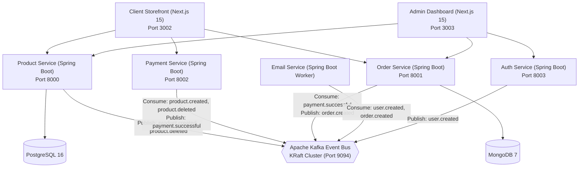

# Java Spring Boot Microservices E-Commerce Platform

A production-ready, event-driven microservices backend rewritten in **Java 21 / Spring Boot 3.4.3** with full API compatibility for the Next.js storefront client and admin dashboard.

---

## Architecture & Communication



---

## Microservices Breakdown

| Service | Port / Role | Database | Key Responsibilities |
| :--- | :--- | :--- | :--- |
| **`common-dto`** | Library | - | Shared DTOs (`ProductDTO`, `OrderDTO`, `CartItemDTO`, etc.) and Kafka event records |
| **`product-service`** | `http://localhost:8000` | PostgreSQL (`productdb`) | CRUD operations for products & categories, dynamic filtering, Kafka event publishing (`product.created`, `product.deleted`) |
| **`order-service`** | `http://localhost:8001` | MongoDB (`orderdb`) | User orders, admin order listing, 6-month order aggregation chart, Kafka consumer (`payment.successful`), publisher (`order.created`) |
| **`payment-service`** | `http://localhost:8002` | - | Stripe Checkout custom session creation, session status retrieval, Stripe webhook handling, Kafka sync for Stripe products |
| **`auth-service`** | `http://localhost:8003` | Clerk / In-Memory | User listing, detail, creation, deletion with Clerk API proxy & local fallback, publishes `user.created` to Kafka |
| **`email-service`** | Background Worker | - | Consumes `user.created` and `order.created` events, sends welcome and order confirmation emails via Spring Mail |

---

## Getting Started

### 1. Start Infrastructure (Docker)

Start PostgreSQL, MongoDB, Kafka, and Kafka UI in the background:

```bash
cd backend
./start-services.sh
# OR manually:
docker compose up -d
```

- **Kafka UI**: [http://localhost:8080](http://localhost:8080)
- **PostgreSQL**: `localhost:5432` (db: `productdb`, user: `postgres`, pass: `postgres`)
- **MongoDB**: `localhost:27017` (db: `orderdb`)

---

### 2. Build All Services

Compile and package all microservices using the Maven wrapper:

```bash
cd backend
./mvnw clean package -DskipTests
```

---

### 3. Run the Services

You can launch each service either via Maven or by running its packaged JAR:

#### Option A: Running via Maven
```bash
# Terminal 1: Product Service (Port 8000)
cd backend/product-service && ../mvnw spring-boot:run

# Terminal 2: Order Service (Port 8001)
cd backend/order-service && ../mvnw spring-boot:run

# Terminal 3: Payment Service (Port 8002)
cd backend/payment-service && ../mvnw spring-boot:run

# Terminal 4: Auth Service (Port 8003)
cd backend/auth-service && ../mvnw spring-boot:run

# Terminal 5: Email Service (Worker)
cd backend/email-service && ../mvnw spring-boot:run
```

#### Option B: Running Fat JARs
```bash
java -jar backend/product-service/target/product-service-1.0.0.jar
java -jar backend/order-service/target/order-service-1.0.0.jar
java -jar backend/payment-service/target/payment-service-1.0.0.jar
java -jar backend/auth-service/target/auth-service-1.0.0.jar
java -jar backend/email-service/target/email-service-1.0.0.jar
```

---

## Frontend Integration

The Next.js storefront (`apps/client`, port 3002) and admin dashboard (`apps/admin`, port 3003) connect to these Java services without any API changes:

- `NEXT_PUBLIC_PRODUCT_SERVICE_URL=http://localhost:8000`
- `NEXT_PUBLIC_ORDER_SERVICE_URL=http://localhost:8001`
- `NEXT_PUBLIC_PAYMENT_SERVICE_URL=http://localhost:8002`
- `NEXT_PUBLIC_AUTH_SERVICE_URL=http://localhost:8003`
